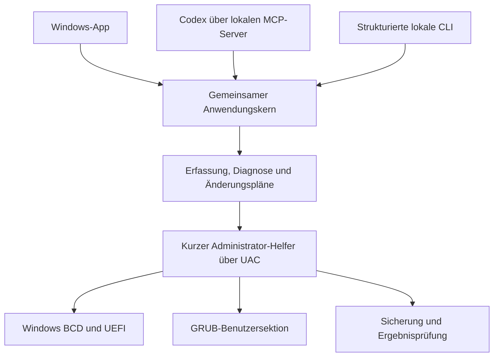

# BootPilot — Entwurf der ersten Version

Stand: 17. Oktober 2026. Der Nutzer hat die Richtung **eigene Windows-App mit Steuerung durch Codex über MCP** und den Funktionsumfang in diesem Entwurf im Chat bestätigt. Die Prüfung dieses schriftlichen Entwurfs steht noch aus.

## Ziel

BootPilot zeigt und verwaltet die vorhandene Windows-/Linux-Bootkonfiguration. Die grafische App und Codex können dieselben strukturierten Funktionen verwenden. Ein Auftrag wie „Zeige meine Bootoptionen“ oder „Bereite CachyOS als Standard vor“ liefert nachvollziehbare Ergebnisse und konkrete Änderungsvorschauen.

Die erste Version verwendet den bereits installierten GRUB aus Grub2Win und verwaltet dessen unterstützte Benutzersektion sowie separate UEFI-Einträge. Sie erzeugt keinen eigenen EFI-Bootloader. Die vorhandene CachyOS-Installation, ihre Kernel-Hooks und Windows bleiben die Ausgangsbasis. Ein erfolgreicher Linux-Start nach dem vorherigen Grub2Win-Wechsel ist weiterhin nicht bestätigt.

## Oberfläche und Funktionen

Eine native Windows-App mit vier Bereichen:

1. **Übersicht:** erkannte Betriebssysteme, tatsächlich gestarteter Firmware-Eintrag soweit verfügbar, Bootreihenfolge, Secure Boot, BitLocker und Zeitpunkt der letzten Erfassung. Nicht verfügbare Werte erscheinen als unbekannt.
2. **Bootmenü:** Windows und erkannte Linux-Einträge; Standardauswahl und Wartezeit; Vorschau einer geänderten Firmware-Reihenfolge; Hinzufügen eines direkten CachyOS-Eintrags aus überprüften Kernelpfaden. Der vorhandene Installer wird als solcher bezeichnet.
3. **Sicherungen:** Änderungsprotokoll, gesicherte Dateien und gezielte Wiederherstellung einer eigenen Änderung.
4. **Codex:** Status und Einrichtung der lokalen MCP-Anbindung sowie Beispiele für mögliche Aufträge. Die KI läuft in Codex; ein zusätzlicher API-Schlüssel ist nicht nötig.

Alle Ansichten verwenden echte Systemdaten. Ein separat gekennzeichneter Demonstrationsmodus darf für Tests und Vorschauen verwendet werden.

## Architektur

Technik: C# und .NET 10 LTS, WPF für die Windows-Oberfläche, offizielles C# MCP SDK für den lokalen stdio-Server. Die Veröffentlichung enthält die benötigte .NET-Laufzeit für Windows x64.

Der Anwendungskern enthält Datenmodelle, Validierung, Änderungsplanung und Wiederherstellung. Windows-Zugriffe sind austauschbare Adapter. Dadurch lassen sich Änderungen an Testdateien und simulierten Firmware-Daten prüfen, ohne die echte Bootkonfiguration anzufassen.

GUI und MCP laufen mit normalen Benutzerrechten. Ein kurz laufender, fest begrenzter Helfer fordert für geschützte Abfragen oder Schreibvorgänge die erforderlichen Administratorrechte an. Der Helfer akzeptiert ausschließlich definierte Aktionen und geprüfte Argumente, keine freien Shell-Befehle oder Skripte.

BCD wird soweit verfügbar über den strukturierten Windows-WMI-Provider abgefragt. Ein notwendiger BCDEdit-Fallback wird ausdrücklich gekennzeichnet und anhand deutscher und englischer Ausgaben getestet. Native UEFI-Variablen können die tatsächliche Bootkette ergänzen. Eine Abfrage mit fehlenden Rechten darf keinen leeren Befund als vollständiges Ergebnis ausgeben.

## MCP-Vertrag

Geplante Werkzeuge, mit derselben Fachlogik wie in der Oberfläche:

- `boot_get_status`: letzte Erfassung und deren Aktualität.
- `boot_refresh`: neue Systemerfassung; kann eine UAC-Abfrage erfordern.
- `boot_diagnose`: belegte Befunde, mögliche Ursachen und offene Prüfungen.
- `boot_plan_order`: konkrete Reihenfolge vorhandener Firmware-Einträge vorbereiten.
- `boot_plan_menu`: Standardauswahl und Wartezeit vorbereiten.
- `boot_plan_cachyos`: überprüfte CachyOS-Kernel-/Initramfs-Einträge vorbereiten.
- `boot_apply_plan`: einen zuvor erzeugten und noch gültigen Plan anwenden.
- `boot_list_backups`, `boot_plan_restore`: eigene Sicherungen anzeigen und gezielte Rücknahme vorbereiten.

Werkzeugantworten enthalten strukturierte Daten sowie eine kurze verständliche Zusammenfassung. Lese- und Schreibwirkungen werden korrekt deklariert. Schreiben erfolgt nur mit einem konkreten Plan; MCP erhält keinen allgemeinen Administratorzugang. Die Codex-Konfiguration wird bei der Einrichtung gesichert, und bestehende Server wie REA bleiben erhalten.

## Ablauf einer Änderung

1. Aktuellen Zustand erfassen und relevante Datei-/Firmwarewerte identifizieren.
2. Eine Vorschau mit alten und neuen Werten, betroffenen Einträgen und nachvollziehbarer Begründung erzeugen.
3. Einen zeitlich begrenzten Plan mit eindeutiger ID und Zustandsprüfsummen speichern.
4. Beim Anwenden den tatsächlichen Zustand erneut lesen. Veraltete Pläne oder parallel geänderte Dateien werden abgelehnt.
5. Vor dem ersten Schreibzugriff betroffene Dateien und die benötigten Firmwarewerte sichern.
6. Ausschließlich die geplanten Änderungen ausführen und anschließend verifizieren.
7. Bei Fehlern die bereits ausgeführten eigenen Schritte zurücknehmen, soweit der Zustand eine sichere Rücknahme erlaubt. Andernfalls den Teilzustand exakt melden.

Eine Wiederherstellung prüft ebenfalls, ob seit der ursprünglichen Änderung weitere Änderungen erfolgt sind. Ein kompletter BCD-Import dient nicht als pauschale Rücknahme. Neustarts sind keine automatische Folge einer Änderung.

## Grenzen der ersten Version

Keine Partitionierung, Formatierung, Löschung von Betriebssystemen, Firmware-Updates oder automatische Änderung von Secure Boot beziehungsweise BitLocker. Der Pfad des Microsoft-Windows-Bootmanagers wird nicht ersetzt. Die App verteilt in dieser Version keine fremden Bootloader-Binärdateien und übernimmt keine Grub2Win-Oberfläche oder Grafiken.

Für Linux werden Pfade, UUIDs und Kernelparameter aus der vorhandenen Konfiguration übernommen und vor Verwendung geprüft. Dynamisch erzeugte oder nicht eindeutig interpretierbare GRUB-Konfigurationen werden angezeigt, aber nicht blind umgeschrieben. Schreiben ist auf die bestätigte Grub2Win-Benutzersektion und unterstützte Menüeinstellungen begrenzt.

## Prüfung und Lieferung

- Tests für Zustandsänderungen, ungültige IDs/Pfade, Konfigurationsdarstellung, veraltete Pläne, Sicherung und Rücknahme.
- Integrationstests gegen temporäre Dateien und simulierte Windows-Adapter, einschließlich Fehlern nach einem Teilschritt.
- Echter MCP-Verbindungstest einschließlich Inventar und einer lesenden Systemabfrage.
- Start und Sichtprüfung der Windows-App; ein realer, ausdrücklich als solcher gekennzeichneter Diagnoselauf.
- Kein echter Boot-Schreibtest und kein PC-Neustart nur zur Entwicklung. Ein späterer Boot-Test wird separat dokumentiert.

Lieferung: startbares Windows-x64-Paket, vollständiger eigener Quelltext, Bedienungs-/Einrichtungsanleitung, Prüfbericht und Codex-MCP-Einrichtung. Entwicklungsdateien liegen unter `work/bootpilot`; überprüfbare Lieferdateien kommen nach `outputs/BootPilot`.

## REA und Quellen

REA wurde für das installierte Artefakt verwendet. Die portable PE-Ressourcenanalyse lehnte dessen Layout ab; eine erfolgreiche Objdump-Untersuchung lieferte `pei-i386` sowie `UPX0`, `UPX1` und `.rsrc`. Das ist statische Evidenz und keine Beobachtung der Programmausführung. Vorhandener AutoIt-Quelltext wurde ergänzend gelesen; seine exakte Übereinstimmung mit der EXE ist nicht bewiesen. Details werden im separaten REA-Bericht festgehalten.

- [Microsoft: WPF](https://learn.microsoft.com/en-us/dotnet/desktop/wpf/)
- [Microsoft: begrenzte Administratorprozesse](https://learn.microsoft.com/en-us/windows/win32/secbp/running-with-administrator-privileges)
- [Grub2Win: Benutzersektion](https://grub2win.sourceforge.io/Managingthebootmenu.html)
- [Limine Entry Tool: gepflegte Kernelpfade](https://gitlab.com/Zesko/limine-entry-tool/-/raw/master/README.md)
